

BSIT student at Bicol University who builds map-based apps, works with AI every day, and creates custom workflows and automations.

##  About Me

**4th-year BSIT student at Bicol University.** I lead the team behind **MerkadoGo**, our capstone: an Android and web smart market guide for the Ligao City Public Market. I designed the market's floor map in Figma, turned its 231 stalls and walkways into structured JSON data, and built the A\* routing that guides shoppers from any of the 14 entrances to the right stall. I refined that algorithm in a web prototype, MerkadoGo Web. I also handle the project's documentation and QA.

I build a lot with AI. I create custom agentic AI workflows for different tasks, from prompt templates to full project setups, and use coding agents like Claude Code, Codex and Antigravity to finish tasks faster. I'm always trying new AI tools, and the next thing I want to explore is fully automated AI workflows.

Right now I build for the web, but networking is where I'm headed. I'm collecting IT certifications and courses along the way.

##  Contact

  
  
  
  
  

##  Projects

<table>
  <tr>
    <td width="50%" valign="top">
      
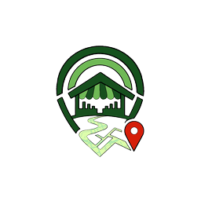

      <b>MerkadoGo</b> 
      Indoor market map and A* wayfinding for 231 stalls of the Ligao City Public Market, with multilingual search (English, Tagalog, Central Bicolano). My part: map design, data model and routing algorithm. 
       <b>Built with</b> 
      <table><tr><td align="center">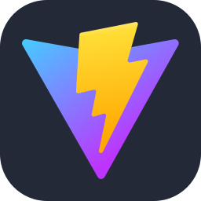 Vite</td><td align="center"> JavaScript</td><td align="center"> SVG</td><td align="center"> Firebase</td></tr></table>
      <a href="https://merkadogo-web.vercel.app">Live demo</a> · <a href="https://github.com/KuraiKutsuki/MerkadoGo-WebApp">Repo</a>
    </td>
    <td width="50%" valign="top">
      
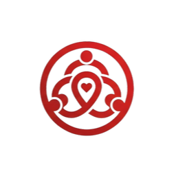

      <b>BayaniLink</b> 
      My solo build of the community-reporting concept from my hackathon teams, extended with my own features: real-time emergency reports for Ligao City's CDRRMO, a live Leaflet map, and a Gemini-powered emergency assistant. 
       <b>Built with</b> 
      <table><tr><td align="center">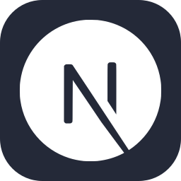 Next.js</td><td align="center"> Supabase</td><td align="center"> TypeScript</td></tr></table>
      <a href="https://bayani-link.vercel.app/">Live demo</a> · <a href="https://github.com/KuraiKutsuki/BayaniLink">Repo</a>
    </td>
  </tr>
</table>

##  Certifications & Achievements

<table>
  <tr>
    <td align="center" width="88">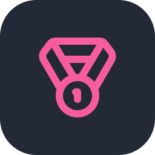</td>
    <td><b>3rd Place</b>, Heroes of Innovation Challenge 2026: Ibalong Festival Hackathon Legazpi City · Aug 2026 Built <b>Saro</b>, a community incident-reporting platform with a live map and an AI chatbot, for the theme "From Epic to Impact: Innovating a Smarter City."</td>
  </tr>
  <tr>
    <td align="center" width="88"></td>
    <td><b>1st Runner-Up</b>, Vibecoding Competition, AI4AI Fair 2026: AI for Rural Development Polangui, Albay · June 2026 Built a community reporting website where authorities track reports on a live interactive map.</td>
  </tr>
  <tr>
    <td align="center" width="88">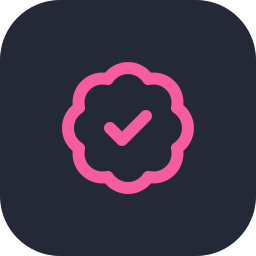</td>
    <td><b>TESDA Java Programming NC III</b></td>
  </tr>
</table>

##  Tech Stack

<b>Languages</b>

<table align="center">
  <tr>
    <td align="center" width="96"> TypeScript</td>
    <td align="center" width="96"> JavaScript</td>
    <td align="center" width="96">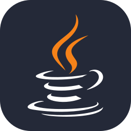 Java</td>
    <td align="center" width="96">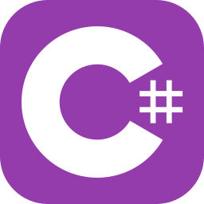 C#</td>
    <td align="center" width="96">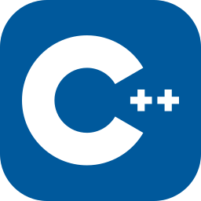 C++</td>
    <td align="center" width="96"> HTML</td>
    <td align="center" width="96"> CSS</td>
  </tr>
</table>

<b>Frameworks</b>

<table align="center">
  <tr>
    <td align="center" width="96"> React</td>
    <td align="center" width="96"> Next.js</td>
    <td align="center" width="96">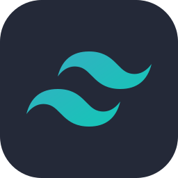 Tailwind CSS</td>
    <td align="center" width="96"> Vite</td>
    <td align="center" width="96">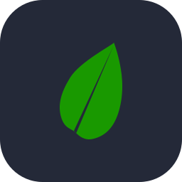 Leaflet</td>
  </tr>
</table>

<b>Backend & data</b>

<table align="center">
  <tr>
    <td align="center" width="96">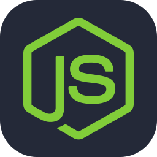 Node.js</td>
    <td align="center" width="96"> Supabase</td>
    <td align="center" width="96"> Firebase</td>
    <td align="center" width="96"> SQLite</td>
  </tr>
</table>

<b>Design</b>

<table align="center">
  <tr>
    <td align="center" width="96">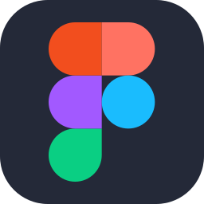 Figma</td>
  </tr>
</table>

<b>Networking</b>

<table align="center">
  <tr>
    <td align="center" width="96">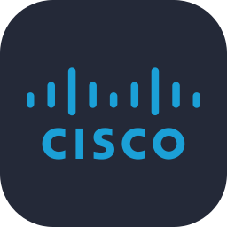 Cisco Packet Tracer</td>
  </tr>
</table>

<b>AI coding</b>

<table align="center">
  <tr>
    <td align="center" width="96">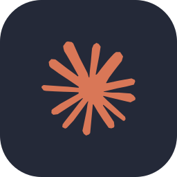 Claude Code</td>
    <td align="center" width="96">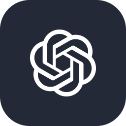 Codex</td>
    <td align="center" width="96">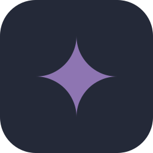 Gemini</td>
    <td align="center" width="96">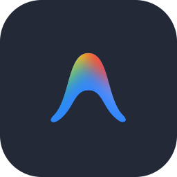 Antigravity</td>
  </tr>
</table>

<b>AI app builders</b>

<table align="center">
  <tr>
    <td align="center" width="96">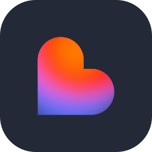 Lovable</td>
    <td align="center" width="96">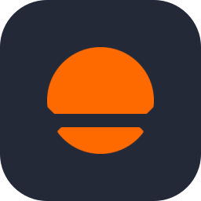 Base44</td>
  </tr>
</table>

<b>Tools</b>

<table align="center">
  <tr>
    <td align="center" width="96"> Git</td>
    <td align="center" width="96"> GitHub</td>
    <td align="center" width="96"> VS Code</td>
    <td align="center" width="96"> Vercel</td>
    <td align="center" width="96">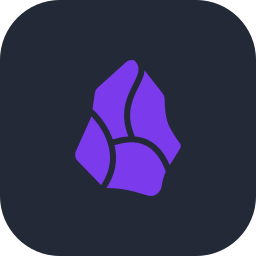 Obsidian</td>
  </tr>
</table>

##  What I'm into

<table align="center">
  <tr>
    <td align="center" valign="top" width="220">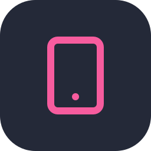 <b>Phone specs</b> Smartphone specs and budget comparisons</td>
    <td align="center" valign="top" width="220">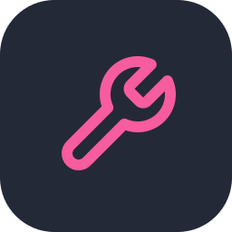 <b>Troubleshooting</b> Smartphone troubleshooting</td>
    <td align="center" valign="top" width="220">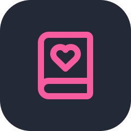 <b>Anime & manga</b> Anime, manga, light novels and manhwa (romance especially)</td>
  </tr>
</table>

